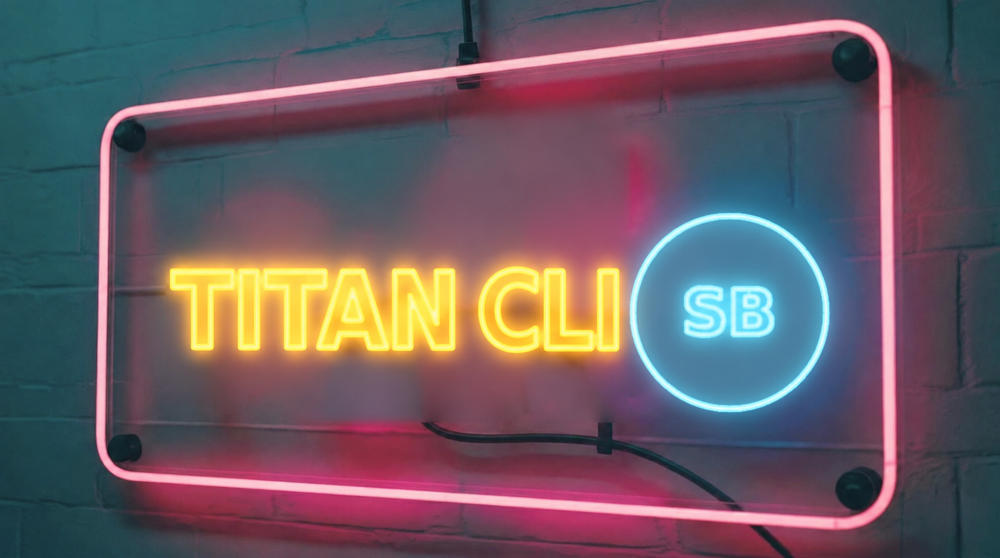

# Titan CLI by SignalBrain



`gh ci-receipt` is the installable command for v0.1. It reads GitHub Actions timing data using your GitHub CLI credentials and produces a **CI Receipt**, a Markdown report you can save or paste into a pull request.

## Quick start

Requires GitHub CLI, Python 3.9+, and read access to the target repository's Actions data. Run `gh auth login` if needed. GitHub.com is supported.

Install from a Git checkout or from the standalone source ZIP. If you extracted the ZIP, initialize its local repository first:

```sh
git init -q
gh extension install .
gh ci-receipt --help
```

Audit recent runs and save a Markdown CI Receipt:

```sh
gh ci-receipt audit OWNER/REPO --workflow ci.yml --runs 10 > ci-receipt.md
```

Compare two completed runs and save the comparison report:

```sh
gh ci-receipt compare 123456789 123456790 --repo OWNER/REPO > ci-receipt-comparison.md
```

You can also run `./gh-ci-receipt` directly. When running from a GitHub checkout, `compare` can infer the repository via GitHub CLI.

## What the CI Receipt measures

- **Wall** measures workflow start to the last recorded non-skipped job completion. It excludes initial workflow queue time and any activity after the last job.
- **Runner time** sums recorded job durations. Parallel jobs can therefore lower wall time while raising runner time. Runner time is separate from GitHub billing.
- **Audit** ranks the median observed duration of each named step within a workflow and job. It reports sample counts and links to the slowest observed example. Use `--workflow` for a narrower sample. Step ranking does not reconstruct the critical path.
- **Compare** flags differences in workflow, event, branch, conclusion and timed workload scope (the non-skipped job names). A pair can differ in workload, cache state or runner class even when these fields match. Use several comparable pairs before making a savings claim.
- **Reruns** report the latest attempt's runner time only. GitHub's attempt endpoint may cover just the rerun jobs, so full-run wall time is unavailable.
- **Coverage** uses Actions run, job and step timestamps. Cache activity inside a composite setup step can only be inspected by following the job log link.

## Development

```sh
python3 -m unittest discover -s tests -v
```

Titan CLI by SignalBrain is a standalone project. The extension does not require a Titan installation, internal Titan source, or private run data.
